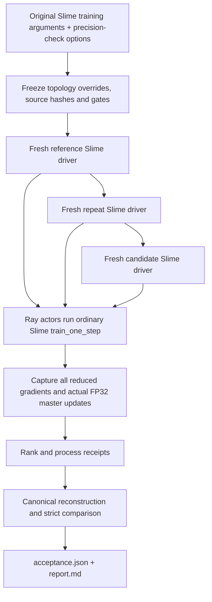

# How validation reaches the training computation

The library owns the experiment contract, observation, and comparison. The
training framework owns model construction, forward/backward execution,
communication, clipping, and optimizer arithmetic. Installing the library does
not make an unsupported model topology executable and does not install numerical
fixes in the model.

## Slime entry

The source installer copies a supplied Slime checkout into a new directory and
checks two integration boundaries: the synchronous driver and the native rank
training loop. Recognized driver variants include the older `train(args)` entry
and the newer `main(args, restore_plan)` entry. Unrecognized structure fails
before the copy is written. Source recognition is separate from GPU runtime
qualification; see the tested source identities in the validation record.



The driver starts each child with its topology flags **before** Slime parses the
arguments. The original configuration is the candidate. Reference overrides
change only named axes; repeat reuses the reference. Input batch size and
optimizer configuration are preserved, while DP is recomputed from the fixed
training world size. The rank bridge calls Slime's real training step once and
stops at the requested optimizer-step boundary. The driver stops after the final
rank receipts appear and its ordinary resource cleanup can run.

Without precision-check options, the driver takes its original entry and does
not import the plugin. The native loop retains an opt-in condition. The first
release entry deliberately performs bounded validation and exits; it is not a
transparent production monitor that resumes ordinary training afterward.

## What a rank records

`slime_check_capture.py` traces the actual DataIterator result before CP slicing.
It hashes token and mask values and their per-sample metadata. Dense DP sample
contributions are counted once; TP/CP/PP replicas must agree. Duplicate samples
remain separate contributions. This checks the data that training consumed,
rather than trusting the name of an input file.

`MegatronParameterMap` maps the framework's local parameters into canonical
names and flat global intervals. Mapping covers supported TP shards, PP layer
ownership, EP expert ownership, and fused parameter layouts. Complete trainable
coverage is required. A missing gradient is not replaced with zero, and a rank
with no owned tensor must still provide its receipt.

`NativeStepObserver` intercepts the real optimizer boundary. It records
post-reduction, unscaled gradients before clipping, snapshots FP32 optimizer
parameters, lets the native update execute, then writes the actual parameter
delta. It does not approximate Adam with a second implementation or call a
second optimizer step. Main gradients, optimizer parameters and states must
have the declared precision. The Slime bridge checks state types, finiteness and
step counters; complete Adam-state-vector comparison belongs to the separate
trajectory protocol.

The first captured step also records canonical initial-parameter identities.
Input contribution, optimizer, schedule, precision, runtime and topology
receipts are checked across stages. All ranks and the outer process must finish
successfully before a stage is sealed.

## Comparison and acceptance

The reader validates the file hashes and global interval coverage, then streams
corresponding FP32 fragments. For reference vector r and candidate vector c:

- max absolute error: `max(abs(c - r))`;
- absolute L2: `sqrt(sum((c - r)**2))`;
- RMSE: `absolute_L2 / sqrt(element_count)`;
- relative L2: `absolute_L2 / sqrt(sum(r**2))`, with explicit near-zero rules.

Reference versus repeat measures the fixture's own variation. Reference versus
candidate measures the declared change. Global gates, parameter/group gates and
forward-observation gates all participate when strict acceptance is configured.
A small parameter cannot hide a large local error inside a large global norm.
Thresholds are frozen before the run; a failed model is not repaired by raising
its thresholds afterward.

`report_only` is intentional when no policy was supplied. Execution failure,
missing receipts, source changes, incomplete intervals and failed numerical
gates are distinct outcomes. Known-good version regression remains necessary
when a bug may be shared by both configurations.

## Integrating a different training framework

Start with an exported template rather than copying private cluster scripts:

```bash
precisionctl adapters
precisionctl init --adapter torch --output ./my-adapter
```

The adapter's prepare side declares the complete parameter catalog, input,
initialization, optimizer, precision, observables, changed configurations and
policy. Its worker constructs the real model and optimizer and executes the
training computation. In the portable Torch example, the essential boundary is:

```python
from precision_validator.sdk import capture_torch_step

def backward_only():
    output = model(inputs)
    loss = objective(output, labels)
    loss.backward()
    return {"loss": loss.detach(), "outputs": output.detach()}

capture_torch_step(
    plan_path, stage, model, optimizer, backward_only,
    checks={"full_batch_contributed": True},
)
```

The callback must not call `optimizer.step()`. The capture function performs the
real optimizer update after observing the gradients. This example's direct Torch
mapping is for its supported unsharded model/optimizer scope. Distributed or
sharded frameworks need a canonical ownership adapter; passing a rank-zero
parameter subset as a full model is invalid.

The native trajectory adapter has a different protocol: multiple frozen inputs,
scheduler progression, complete optimizer-state vectors, a checkpoint boundary,
and a distinct process for the resumed suffix. Stage-specific precision contracts
permit declared FP32/BF16 storage comparisons after exact initial-value alignment.
Those contracts must be selected explicitly; they are not inferred from dtype
names or shared with the initial one-step protocol.

## Reproducing a report audit

The installed-wheel verifier checks imports away from source and hashes every
installed package file. GPU runners likewise verify the supplied wheel before
launching model tests. `scripts/audit_small_report.py` provides an independent
NumPy calculation for small Slime report fixtures. It rebuilds every vector and
checks global and local error metrics without importing the comparison engine.
It verifies arithmetic and interval coverage, not the semantic correctness of a
framework's parameter mapping.
